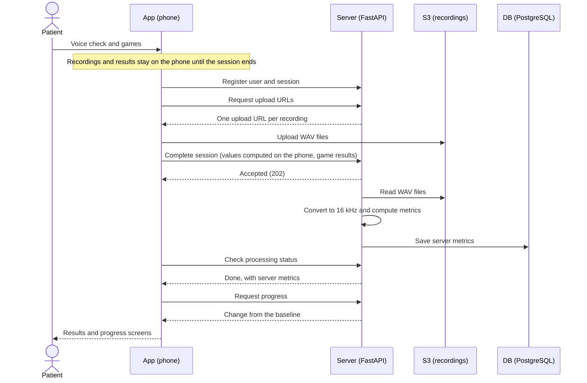

# dySpeech

[한국어](README.md) | **English**

2026 fall semester industry and academia collaboration project

dySpeech is a voice training app for people with dysarthria after a stroke. They use it on their own at home, without a therapist. Each session starts with a short voice check, followed by games that practice breathing, speech rate and intonation. The server computes metrics from the recordings and reports how they have changed since the first session.

## What it does

- **Voice check (measurement block)**: At the start of every session, the app records 2 seconds of silence, a long "ah" 2 to 3 times, and a fixed sentence read aloud. In the first session, it measures the user's comfortable pitch range first.
- **Games**: The goals are set from the voice check values, and the level goes up or down with each round's result.

  | Area | Games |
  | --- | --- |
  | Breath control | Blow Up the Balloon, Keep the Candle Lit |
  | Speech rate | Pace Reading |
  | Voice and intonation | Spaceship, Roller Coaster |

- **Progress**: The server compares each metric with the first session (the baseline) and reports whether the change is larger than measurement error (the minimal detectable change). It does not judge whether the user got better or worse. It only gives the desirable direction for each metric.
- The screens can be shown in Korean or English. The sentences the user reads aloud stay in Korean.

## How it works



- The app sends data only after a session ends. There is no real-time communication. If sending fails, the app retries a few times. If it still fails, the session stays on the phone and is sent the next time the app is opened or brought back to the front.
- Only values the server computes from the recordings are official. Values the app computes on the phone are used to set game goals, and the server only stores them.
- The app uploads recordings straight to S3, not through the server. The server computes received sessions one at a time in a processing job that runs inside the server.
- Request and response formats are described in [`docs/api.md`](docs/api.md) (Korean).

## Folder structure

```
dySpeech/
├── frontend/                App (Expo, TypeScript)
│   ├── assets/              App icons
│   └── src/
│       ├── app/             Screens. The file path is the screen route (Expo Router)
│       │   ├── (tabs)/      Bottom tabs: Home, Records, Settings
│       │   ├── onboarding/  First launch (profile, consent)
│       │   ├── session/     Voice check, sending and waiting, results, resuming an unfinished session
│       │   └── games/       Choosing an area and a game, playing, finishing today's training
│       ├── components/      UI parts shared by several screens
│       ├── data/            Names and colors of game areas, sample data for the clinician screen
│       ├── games/           The five games and the game registry
│       ├── i18n/            Korean and English screen text
│       ├── measurement/     Voice check recording, recording checks, metrics computed on the phone
│       ├── session/         Saving sessions, sending them to the server and resending
│       └── training/        Today's training flow, saved game levels, game baselines
├── backend/                 Server (FastAPI, Python 3.13)
│   ├── app/
│   │   ├── api/             API endpoints
│   │   ├── schemas/         Request and response formats
│   │   ├── metrics/         Computing metrics from recordings
│   │   ├── jobs/            Processing job that computes completed sessions one at a time
│   │   ├── db/              Database tables and connection
│   │   ├── storage/         Recording files on S3, WAV format checks
│   │   └── config/          Metric definitions, evaluation sentence
│   ├── migrations/          Database schema history (Alembic)
│   ├── analysis/            Tools for validating and analyzing metrics
│   ├── tools/               Inspection and cleanup tools
│   ├── fixtures/            Notes on synthetic test signals with known answers and automatic gain control test tones
│   └── tests/               Server tests (pytest)
└── docs/                    API specification, metric definitions, validation record, development guide
```

## Further reading

The documents below are written in Korean.

| Document | Contents |
| --- | --- |
| [`docs/development.md`](docs/development.md) | Development setup, commit rules, common errors, backend tools |
| [`docs/api.md`](docs/api.md) | API specification (upload order, recording file format, errors, progress response) |
| [`docs/metrics-spec.md`](docs/metrics-spec.md) | Metric definitions and how the server computes them |
| [`docs/validation.md`](docs/validation.md) | Record of how accurately the metrics are computed |
| [`frontend/src/games/README.md`](frontend/src/games/README.md) | How to connect a game to the app |
| [`frontend/src/session/README.md`](frontend/src/session/README.md) | Saving sessions, sending them to the server, the voice check screen |

If you are joining development, start with the commit rules and initial setup in [`docs/development.md`](docs/development.md).
