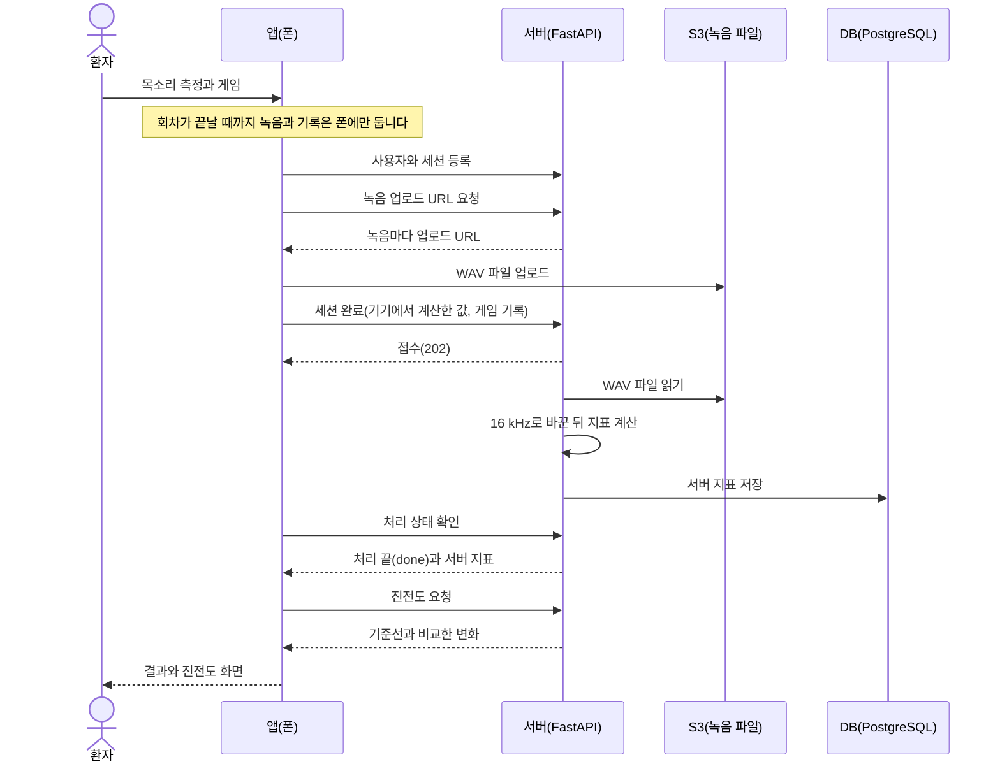

# dySpeech

2026 2학기 산학 프로젝트

뇌졸중 뒤 마비말장애가 있는 환자가 치료사 없이 집에서 혼자 쓰는 발성 훈련 앱입니다. 회차마다 짧게 목소리를 재고, 호흡, 말 속도, 억양을 연습하는 게임을 합니다. 서버는 녹음에서 지표를 계산해 첫 회차와 비교한 변화를 알려 줍니다.

## 하는 일

- **목소리 측정(측정 블록)**: 회차를 시작할 때마다 조용히 2초 있기, "아" 길게 내기 2~3번, 정해진 문장 읽기를 녹음합니다. 첫 회차에는 목소리 높낮이 범위를 먼저 잽니다.
- **게임**: 측정한 값을 기준으로 목표를 정하고, 라운드 결과에 따라 단계가 오르내립니다.

  | 영역 | 게임 |
  | --- | --- |
  | 호흡 조절 | 풍선 불기, 촛불 지키기 |
  | 말 속도 | 속도 맞춰 읽기 |
  | 목소리와 억양 | 우주선 게임, 롤러코스터 게임 |

- **진전도**: 서버가 계산한 지표를 첫 회차(기준선)와 비교해, 변화가 측정 오차(최소 측정 가능 변화량)보다 큰지 알려 줍니다. 좋아졌는지 나빠졌는지는 판정하지 않고, 지표마다 바람직한 방향만 함께 줍니다.
- 화면은 한국어와 영어 중에서 고를 수 있습니다. 읽는 문장은 한국어 그대로입니다.

## 동작 흐름



- 앱은 회차가 끝난 뒤에만 서버로 보냅니다. 실시간 통신은 없습니다. 보내지 못하면 몇 번 다시 보내 보고, 그래도 안 되면 폰에 두었다가 다음에 앱을 켜거나 다시 열 때 보냅니다.
- 공식 값은 서버가 녹음에서 계산한 값뿐입니다. 앱이 폰에서 계산한 값은 게임 목표를 정하는 데 쓰고, 서버는 저장만 합니다.
- 녹음 파일은 서버를 거치지 않고 앱이 S3에 바로 올립니다. 서버는 받은 세션을 서버 안의 처리 작업에서 하나씩 계산합니다.
- 요청과 응답의 자세한 형식은 [`docs/api.md`](docs/api.md)에 있습니다.

## 폴더 구조

```
dySpeech/
├── frontend/                앱 (Expo, TypeScript)
│   ├── assets/              앱 아이콘
│   └── src/
│       ├── app/             화면. 파일 경로가 곧 화면 경로입니다(Expo Router)
│       │   ├── (tabs)/      아래 탭 화면: 홈, 기록, 설정
│       │   ├── onboarding/  첫 실행 화면(프로필, 동의)
│       │   ├── session/     목소리 측정, 보내고 기다리기, 결과, 못 끝낸 회차 이어 하기
│       │   └── games/       영역과 게임 고르기, 게임 실행, 오늘 훈련 끝
│       ├── components/      여러 화면이 같이 쓰는 화면 부품
│       ├── data/            게임 영역의 이름과 색, 임상가 화면 예시 데이터
│       ├── games/           게임 다섯 개와 게임 등록부
│       ├── i18n/            한국어와 영어 화면 문구
│       ├── measurement/     목소리 측정 녹음, 녹음 검사, 폰에서 계산하는 지표
│       ├── session/         회차 저장, 서버로 보내기와 다시 보내기
│       └── training/        오늘 훈련 흐름, 게임 단계 저장, 게임 기준값
├── backend/                 서버 (FastAPI, Python 3.13)
│   ├── app/
│   │   ├── api/             API 엔드포인트
│   │   ├── schemas/         요청과 응답 형식
│   │   ├── metrics/         녹음에서 지표 계산
│   │   ├── jobs/            완료된 세션을 하나씩 계산하는 처리 작업
│   │   ├── db/              DB 테이블과 연결
│   │   ├── storage/         S3 녹음 파일, WAV 형식 검사
│   │   └── config/          지표 정의, 평가 문장
│   ├── migrations/          DB 구조 변경 기록(Alembic)
│   ├── analysis/            지표 검증과 분석 도구
│   ├── tools/               점검과 정리 도구
│   ├── fixtures/            시험용 합성 신호와 정답값, 자동 게인 조절 시험 소리 설명
│   └── tests/               서버 테스트(pytest)
└── docs/                    API 명세, 지표 정의, 검증 기록, 개발 문서
```

## 더 읽을 곳

| 문서 | 내용 |
| --- | --- |
| [`docs/development.md`](docs/development.md) | 개발 환경 설정, 커밋 규칙, 자주 나는 오류, 백엔드 도구 |
| [`docs/api.md`](docs/api.md) | API 명세(업로드 순서, 녹음 파일 규격, 오류, 진전도 응답) |
| [`docs/metrics-spec.md`](docs/metrics-spec.md) | 지표의 정의와 서버 계산 방법 |
| [`docs/validation.md`](docs/validation.md) | 지표 계산이 얼마나 맞는지 확인한 기록 |
| [`frontend/src/games/README.md`](frontend/src/games/README.md) | 게임을 앱에 붙이는 약속 |
| [`frontend/src/session/README.md`](frontend/src/session/README.md) | 회차 저장과 서버로 보내는 흐름, 목소리 측정 화면 |

개발에 참여한다면 [`docs/development.md`](docs/development.md)의 커밋 규칙과 초기 세팅부터 봐 주세요.
